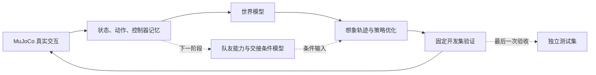

# 人形机器人协作传接球 · 世界模型研究

目标是在 MuJoCo 中实现两台机器人**面对面接稳球、交换角色、连续互传**，并研究：当双方能力不断变化时，世界模型如何帮助合作技能持续提升。

当前用 G1 的现成足球技能验证机制，最终目标是 Booster K1。G1 与 K1 的关节、模型和策略接口不同，需要分别适配。项目仍处于基线验证阶段，尚未证明新架构有效，也尚未实现稳定连续互传。

## 现在做到哪里

| 部分 | 状态 |
|---|---|
| K1 场地、足球、接触动力学参数接口 | 已实现；摩擦等仍需实测标定 |
| 两台浮动基座 G1、同一物理世界中的足球 | 已实现；复用 Joga 公开部署技能 |
| 物理世界模型、想象中的策略优化 | 已实现；历史实验出现峰值后退化 |
| 执行与想象中的控制器一致性 | CPU 8 项通过；GPU 299 步 × 16 环境通过 |
| 固定条件复测与冻结轨迹预测 | 已完成，见实测结果 |
| 正常更新显存/数值检查 | 正在执行；通过后启动正式对照 |
| 三种发送方控制方式的配对训练 | 通过前置检查后执行 |
| 双方共同学习、跨队友泛化、连续互传 | 后续阶段 |

最新实测见 [复测与预测误差](results/2026-11-10-control-audit/README.md) 和 [进展](docs/STATUS.md)，工作顺序见 [任务](docs/TASKS.md)，决策见 [日志](docs/CHANGELOG.md)。

## 研究思路

“世界模型 + 递归自我改进”本身已有相关工作。我们的候选问题是：**学习双方的交接条件与能力变化，能否在提升新合作能力时保留已有合作，并适应未见过的队友？** 这仍是假设，需要消融和多次独立实验支持。



先修复基线，再判断退化原因，最后加入协作机制。具体方案与相近工作见 [研究计划](docs/RESEARCH_PLAN.md) 和 [文献边界](simulation/research/cooperative_handoff/literature/survey.md)。

## 快速开始：G1 GPU 原型

验证环境：Linux、Python 3.11、NVIDIA GPU；MuJoCo/Warp 与依赖版本固定在 requirements 中。当前试验使用 2048 个环境、batch 1024、microbatch 128、WM 宽度 2048。GPU 检查需实际 CUDA 设备和下载的部署资源。

```bash
git clone https://github.com/Raphinha2006/Humanoid_Cooperative_Soccer.git
cd Humanoid_Cooperative_Soccer/simulation
python3.11 -m venv .venv-g1
.venv-g1/bin/pip install -r requirements-g1-gpu.txt
.venv-g1/bin/python tools/fetch_joga.py
export PYTHONPATH=.

# CPU 接口/回放检查；随后检查真实执行与想象控制的一致性
.venv-g1/bin/python -m pytest tests/test_gpu_receive.py tests/test_sender_consistency.py -k 'not closed_loop' -q
CUDA_VISIBLE_DEVICES=0 .venv-g1/bin/python -m pytest tests/test_sender_consistency.py -k closed_loop -q -s

# 从原生技能初始化的新训练；sender-control 可选 held / recorded / closed_loop
CUDA_VISIBLE_DEVICES=0 MUJOCO_GL=egl .venv-g1/bin/python -m soccer_sim.gpu_receive.train \
  --out runs/closed_loop_seed104 --num-envs 2048 --eval-num-envs 512 \
  --batch 1024 --micro 128 --wm-width 2048 --njmax 1024 \
  --sender-control closed_loop --controller-kinematics current \
  --matched-imagination-starts --seed 104 --new-updates 512 \
  --eval-iterations 32 --checkpoint-seconds 1800 --hours 6 --no-render
```

`recorded` 使用真实记录的未来发送方动作，是诊断用的 oracle，不能作为可部署方法。`held` 将发送方目标保持不变；`closed_loop` 根据预测状态更新发送方控制器及记忆。三组比较保持其他配置一致。

完整配对协议、历史检查点的需求和运行队列见 [预注册协议](simulation/research/cooperative_handoff/experiments/00_control_consistency/protocol.md) 与 [运行说明](docs/EXPERIMENTS.md)。历史大体积检查点未随代码发布；上面的新训练不等同于复现历史续训结果。

## 场地、球与摩擦在哪里改

| 内容 | 入口 |
|---|---|
| K1 场地 14 × 9 m、球门、球尺寸/质量、接触参数 | [配置](simulation/configs/hsl_m_3v3.yaml)、[参数表](simulation/docs/PARAMETERS.md) |
| G1 原生场景、31 关节控制、0.11 m / 0.43 kg 足球 | [配置](simulation/configs/supermimic_g1_receive.yaml)、[参数表](simulation/docs/G1_PARAMETERS.md) |
| 参数覆盖、接触对优先级、质量与惯量 | [覆盖示例](simulation/configs/joga_physics_overrides.example.yaml) |
| K1 模型/技能下载与运行 | [仿真说明](simulation/README.md) |

场地尺寸引用固定版本的 HSL 规则源码，并注明其开发稿身份。**没有统一的官方草地摩擦系数**；当前摩擦、接触软硬度和球参数中的工程初值均明确标识，保留后续标定与修改接口。两套场景的球参数不能混用。

## 结果与更新约定

严格接球要求先发送方接触、后接收方接触，球移动至少 2 m，在接收方正前方以低速连续保持 0.8 s，双方朝向误差不超过 30°，且不跌倒。完整几何条件以代码和协议为准。

每轮记录配置、源文件哈希、训练步数、真实仿真指标和失败原因；开发集选模型，预留独立集做最终验收。未达训练预算、OOM 或中断会如实记为未完成。实质进展同步到状态、日志与任务文件，再提交到 GitHub。

## 复用与许可

复用了 SuperMimic-mjlab 的部分网络/FK 实现，保留原 Apache-2.0 许可和来源；本项目并非官方完整复现。Joga、Booster、B-Human、NUbots、SONIC 等外部模型和权重通过固定版本/校验和下载，未打包进仓库。代码许可见 [LICENSE](LICENSE)，逐项来源见 [NOTICE](NOTICE.md)。
