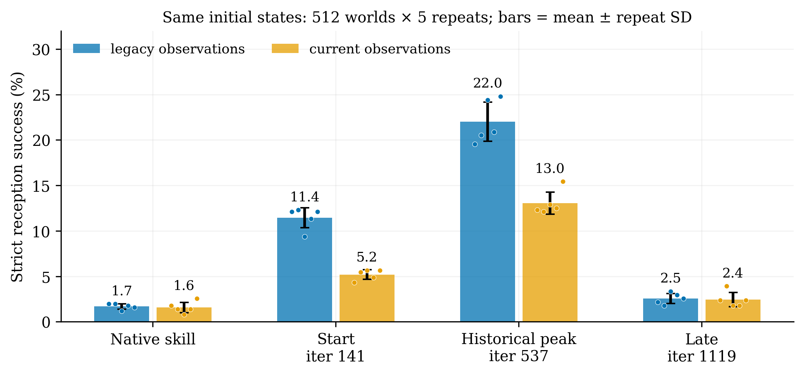
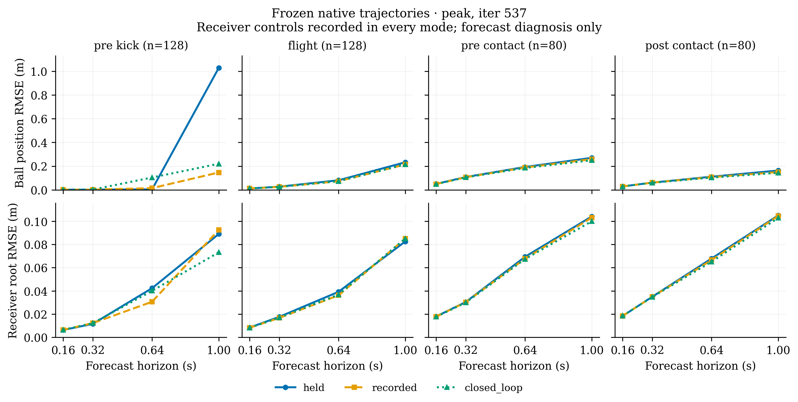

# 固定初态复测与冻结轨迹诊断

日期：2026-11-10。全部为 MuJoCo 仿真结果；这组实验不使用独立验收集。

## 接球复测

同一组 512 个初态（开发 seed220000），每个检查点重复 5 次并交替加载顺序。保存并逐项核对精确 qpos/qvel。以下为**重复均值 ± 标准差，单位 %**；不是 5 个独立训练种子的结果，也不是置信区间。

| 控制器观测 | 原生技能 | 起点 iter141 | 历史峰值 iter537 | 晚期 iter1119 |
|---|---:|---:|---:|---:|
| legacy | 1.68 ± 0.29 | 11.45 ± 1.09 | 22.03 ± 2.16 | 2.54 ± 0.55 |
| current | 1.56 ± 0.58 | 5.20 ± 0.53 | 13.05 ± 1.22 | 2.42 ± 0.79 |

**判断：**在这组开发条件上，峰值到晚期的退化明显大于重复评估波动。切换 current 观测时序也会改变旧策略表现，修复后的训练必须从自己的起点评估，不能直接把 legacy 峰值当作新组起点。

这些是预先选定的历史检查点，之前已经使用开发集选过峰值。复测不能估计整套训练的独立重复性，不能证明退化的具体成因，也不是新方法提升证据。seed250000 的单次额外探针保存在原始 results 中，仍属于开发诊断。

## 冻结轨迹误差

用原生技能在 current 模式下生成 128 条、每条 300 步的真实轨迹（seed225300），对相同状态做 8/16/32/50 步预测。接触前后窗口共有 80 条符合条件的轨迹。误差为三维欧氏位置误差的 RMS，单位 m。

所有模式均使用记录的接收方控制，只改变发送方输入：保持目标、未来记录控制、按预测状态闭环更新控制器。因此这是发送方近似/WM 的诊断，不是可部署的完整闭环效果评估。接触窗口按真实事件划分，不能当作部署时已知信息。

0.64 s（H32）时球位置 RMSE：

| 检查点 / 阶段 | held | recorded | closed_loop |
|---|---:|---:|---:|
| 峰值 / 接触前 | 0.193 | 0.188 | 0.185 |
| 晚期 / 接触前 | 0.133 | 0.138 | 0.135 |
| 峰值 / 踢球前 | 0.004 | 0.015 | 0.105 |

**判断：**在本次原生技能轨迹上，改用真实发送方控制没有消除接触前误差，不能认为发送方近似已被证实是退化主因。闭环模式在峰值 WM 的踢球前窗口反而更差，需要结合历史模型的数据分布检查。晚期模型有些位置误差更小，但策略接球率更低，说明状态 RMSE 不足以代替控制效果验证。

三个模型训练时长不同，且都来自修复前的历史训练。上述观察仅用于诊断；不能据此判定哪一种新训练方式最好。下一步是正常预算配对续训和真实动作扰动收益排序。

## 数据与复现

- `legacy/current_manifest.json`：检查点 SHA-256、迭代、种子、模式和评估规模；服务器路径已移除。
- `legacy/current_results.json`：每次评估的汇总及每环境结果。
- `legacy/current_summary.json`：重复评估汇总。
- `forecast_errors.json`：完整分阶段、分检查点、分预测长度的误差和轨迹哈希。
- [绘图脚本](../../figures/gen_fig_control_audit.py)：在安装 matplotlib/numpy 后运行，生成 PNG300dpi 与矢量 PDF。

真实完整状态轨迹和历史权重未打包，因而当前公开数据可重画图表，不能独立重跑历史检查点仿真。
