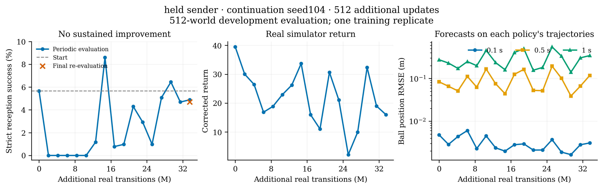

# 配对续训进度：已完成第一组，第二组已启动

日期：2026-11-11（北京时间）。当前只完成 9 组中的 **1 组**，不能比较三种发送方处理方法的优劣。

## 已完成：seed104 / held

共同起点 iter141，追加 512 次更新，结束于 iter653。新增训练交互 **33,554,432**，热启动 614,400 条另计。训练约 **1 小时 53 分钟**；2048 环境、batch1024、micro128、WM2048、H32，无容量溢出。

同一开发集 512 个环境、current 观测模式，严格接球结果：

| 指标 | 数值 |
|---|---:|
| 起点 | 5.66%（29/512） |
| 开发集选出的峰值 | 8.59%（44/512，iter365，追加224次更新） |
| 最后一次定期评估 | 4.88%（25/512） |
| 完成时再次评估 | 4.69%（24/512） |
| 最后四次定期评估均值 | 5.27% |
| 真实仿真回报：起点 → 完成 | 39.47 → 16.53 |

**判断：没有稳定提升。** 早期多次评估为零，中间短暂出现峰值，后期回落；峰值本身不能代表稳定能力。最后两次评估使用同一检查点仍有 1/512 的差别，也提醒我们要区分评估波动与训练变化。这是单个续训随机种子、单一开发集，未使用独立验收集。

球位置预测误差（RMSE，m）：

| 预测长度 | 起点 | 完成时 |
|---|---:|---:|
| 0.1 s | 0.00478 | 0.00293 |
| 0.5 s | 0.08344 | 0.11018 |
| 1.0 s | 0.27476 | 0.33561 |

这些误差来自各检查点自身策略产生的评估轨迹，数据分布会变化，不能等同于固定轨迹上的模型排名或退化原因证据。当前结果仅说明：共同一致性修复和匹配窗口之后，held 对照的这次续训仍不稳定；记录和闭环发送方的作用尚未验证。

## 为什么没有继续跑完九组

第一组正常完成后，第二组 `seed104_recorded` 启动前发现 GPU1 空闲显存不足 **10,000 MiB**。原队列等待 30 分钟，在 **11月11日 00:51:56** 退出。它没有启动第二组，也没有发生训练 OOM。

已建立恢复队列，核验第一组设置、完整预算、最终检查点和冻结源文件哈希后，跳过已完成组，只继续剩余八组。随后复核启动余量，改为 held/recorded **7 GiB**、closed_loop **8.5 GiB**，第二组已进入启动流程，并记录完整进程显存。

资源等待上限延长至每组 12 小时；训练参数、种子顺序、交互预算和评估口径均不变。启动门槛的修订见[显存说明](../../simulation/research/cooperative_handoff/experiments/00_control_consistency/memory_admission_20261111.md)；它是暂定资源余量，不是最低显存测量。原失败状态与检查点保留，恢复队列另存心跳和记录。操作补充说明见[恢复记录](../../simulation/research/cooperative_handoff/experiments/00_control_consistency/recovery_20261111.md)。

## 文件

- `metrics.json`：本组完整训练及开发评估日志。
- `best.json`：开发集选中的峰值，不是独立验收结果。
- `cfg.json`：本组主要训练设置。
- `queue_event.json`：原队列退出原因与北京时间。
- [绘图脚本](../../figures/gen_fig_pilot_progress.py)：重画 PNG 与矢量 PDF。

下一步仍是完成记录/闭环发送方对照与后续随机种子；本组结果不足以确认发送方近似、奖励或世界模型梯度中的哪一项主导退化。

## 下调门槛后的实测

北京时间02:04的快照：第二组已到iter145，至少完成4次追加更新，无容量溢出；本进程每5秒采样得到的最高占用为4,686 MiB，约4.58 GiB。它包含该进程的Torch、Warp和CUDA占用，与仅看Torch缓存不同。它是当前已采样最大值，不是最低需求，也不是整段训练的精确峰值。完整快照见 `recorded_resource_snapshot.json`。
