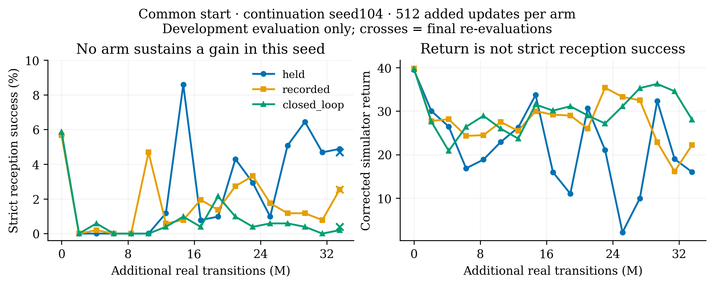

# seed104 三组完成：尚无稳定提升

北京时间2026-11-11 09:21快照：**已完成3/9组，正在运行第4组 seed105_recorded**。队列正常；未发生新训练OOM或容量溢出。第4组日志已到iter170，至少追加29/512次更新。

## 相同预算下的第一轮比较

三组均从同一iter141检查点继续，使用2048环境、batch1024、micro128、H32和current控制器观测。每组追加512次更新、33,554,432条训练交互，另有相同热启动。严格接球率在同一512环境开发集评估，未使用独立验收集。

| 发送方处理 | 起点 | 训练中最高，不含起点 | 完成时 | 最后4次定期评估均值 |
|---|---:|---:|---:|---:|
| held：保持发送方目标 | 5.66% | 8.59% | 4.69%（24/512） | 5.27% |
| recorded：记录的未来发送方动作 | 5.66% | 4.69% | 2.54%（13/512） | 1.42% |
| closed_loop：预测状态下更新发送方 | 5.86% | 2.15% | 0.39%（2/512） | 0.29% |

**当前判断：三个处理在这个续训种子下都未保持相对起点的提升，闭环组退化最明显。** recorded与closed_loop的最优保存检查点仍是起点，而非新训练产生的策略。不能把三个处理当作三个独立随机种子；seed105/106尚需完成，方法总体排序和退化机制仍未确定。

recorded使用真实记录的未来发送方动作，是oracle输入诊断；它不是可部署策略。closed_loop在真实状态输入下通过控制器一致性检查，仍不保证其在有误差的预测状态上产生有用的策略梯度。

## 其他指标

| 完成时指标 | held | recorded | closed_loop |
|---|---:|---:|---:|
| 真实仿真回报 | 16.53 | 21.41 | 27.70 |
| 球0.5秒位置RMSE（m） | 0.110 | 0.163 | 0.036 |
| 实际训练时间（小时） | 1.88 | 2.07 | 3.39 |
| 完整进程采样最高显存（GiB） | 未采样 | 4.60 | 6.90 |

回报更高或该组轨迹上的位置RMSE更低，并不对应更高的严格接球率。误差来自各自策略的评估轨迹，分布不同，不能据此给世界模型做固定数据集排名或确定退化原因。设备由其他任务共享，耗时也不是等资源速度基准。显存每5秒采样一次，不是精确瞬时峰值。

## 后续

继续预注册的seed105/106对照，保持算法和预算不变；当前在GPU1训练，不再因原来统一10GB门槛停等。资源条件变化时，队列仍按已记录的分组门槛等待。当前接球表现尚不满足稳定互传demo目标。

完整数据在 `comparison.json`，汇总在 `summary.json`；[绘图脚本](../../figures/gen_fig_seed104_comparison.py)可生成PNG300dpi和矢量PDF。每组最终检查点哈希包含在原始数据的receipt中，权重不随仓库分发。
