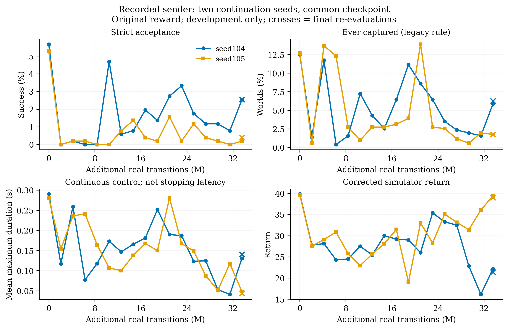

# seed105_recorded完成：仍未建立接球改善

北京时间2026-11-11 12:38快照：完成4/9组，GPU1运行第5组seed105_closed_loop。该组刚开始，尚无训练后的周期评估。当前仍使用原奖励与原协议，新评估器和新奖励尚未接入。独立验收集未用。

## 完整预算与结果

seed105_recorded从共同iteration141起点重跑，完成512次追加更新、33,554,432条新训练交互，用时2.28小时；中断的第一次尝试保留归档，不混入正式比较。

| 开发集指标（512环境） | 该组起点 | 完成时 |
|---|---:|---:|
| 严格接球成功率 | 5.27%（27/512） | 0.39%（2/512） |
| 双方按顺序触球 | 58.59% | 58.59% |
| 曾满足旧连续捕获条件 | 12.70% | 1.76% |
| 最长连续控球保持时长的回合均值 | 0.281 s | 0.044 s |
| 真实仿真总回报 | 39.66 | 38.94 |
| 跌倒率 | 0% | 0% |

训练后的周期评估峰值仅1.56%（iteration461，追加320次更新），没有超过起点。按原规则保存的best仍是起点。

这里的连续控球保持是旧联合条件下的持续时间，越长越好；它不是从触球到停住球的耗时。旧日志不足以计算新定义的准确停球耗时。联合保持量下降可能来自接触、位置、朝向或稳定性变化，不能单独确定原因。

## 能判断与不能判断

recorded处理的两个已完成续训种子都出现末期严格接球与旧连续保持指标下降，尚未观察到持续改善。seed105总回报接近起点，但任务指标大幅下降，进一步说明总回报不能单独作为接球进展依据。

这支持继续验证奖励/任务错配与WM动作效果等假设；不构成唯一原因的因果证明。仅两个recorded种子，其他处理的多种子对照未完成，不据此给所有方法排名。图中原始开发点不作平滑，没有把两个种子当作大量独立训练重复。

## 运行与复现

- 当前第五组seed105_closed_loop正常运行；该快照时尚无训练后评估，不能使用它的起点评分冒充学习效果。
- 第四组完整进程采样最高5,634 MiB，约5.50 GiB；训练环境2048、batch1024、micro128等保持原配置，源文件指纹未改。采样非精确瞬时峰值。
- [progress.json](progress.json)保存完整指标、设置白名单、checkpoint收据和队列快照；[summary.json](summary.json)保存关键摘要。
- 绘图脚本：[gen_fig_recorded_seed105.py](../../figures/gen_fig_recorded_seed105.py)。复现需本报告progress.json和[seed104原始数据](../2026-11-11-seed104-comparison/comparison.json)，以追加真实交互数为横轴，叉号是最终重新评估。
- 评估与奖励的后续工作见[计划](../../docs/RESEARCH_PLAN.md)和[任务](../../docs/TASKS.md)，尚未将设计草案当作已实现成果。
