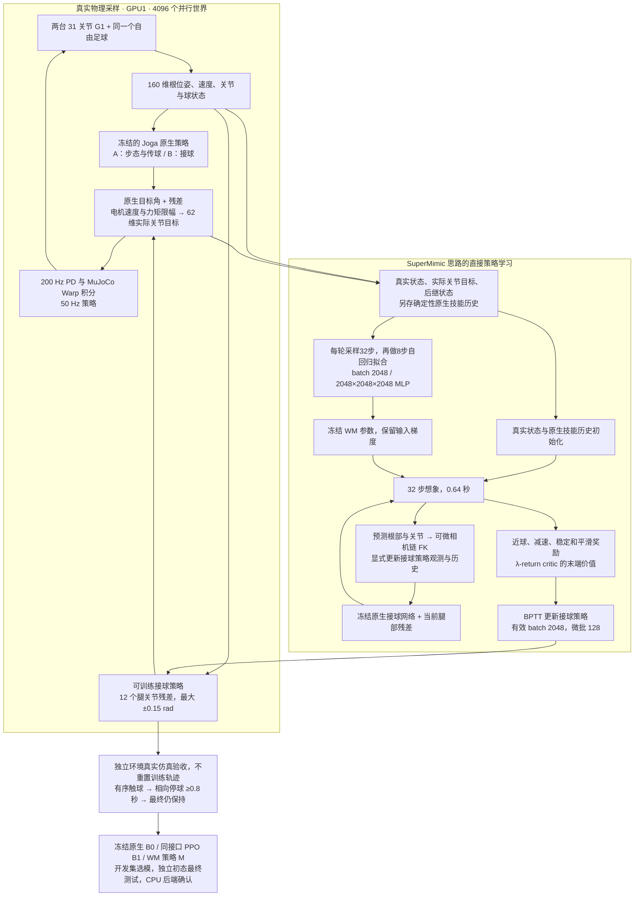
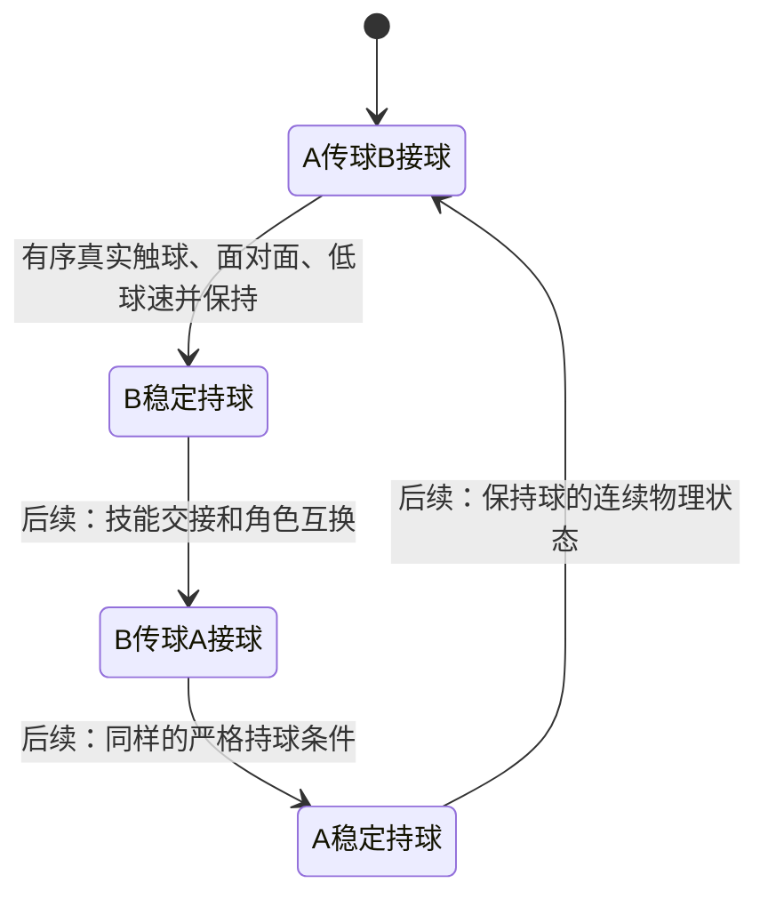

> 历史实验文档。当前研究状态以[根 README](../../README.md)和[实验协议](../research/cooperative_handoff/experiments/00_control_consistency/protocol.md)为准。

# G1 当前 GPU 训练架构

这是 `soccer_sim/gpu_receive/` 的实际入口，区别于保留的 30 轮 CPU 实验。先验收单次面对面 A→B 接球；连续互传尚未完成。

原生技能历史由控制器维护，不是 WM 的预测目标。WM 接收真正执行的关节目标；没有规划教师或 OPD。发送方在想象窗口内保持当前关节目标，真实采样时继续执行原生策略，这是当前近似。

复用的是固定版本社区 SuperMimic 的 ActorCritic、RunningNorm、FK 与多步模型/BPTT/critic 思路；不声称完整官方复现。策略使用仿真真值，视觉闭环、接到球后的角色交换、双方反复互传均是后续独立验收项。

`prediction.py` 另保存不进入 replay 的原生技能固定轨迹，以已知真实关节目标比较 WM 和恒速预测器，报告球、根部、身体和双脚的误差。该测试用于分离预测能力与控制能力，不能替代真实接球成功率。

第二张图是循环传接的目标状态机，当前训练仅覆盖第一条传接及持球判断；仿真 reset 不算完成角色交换。
