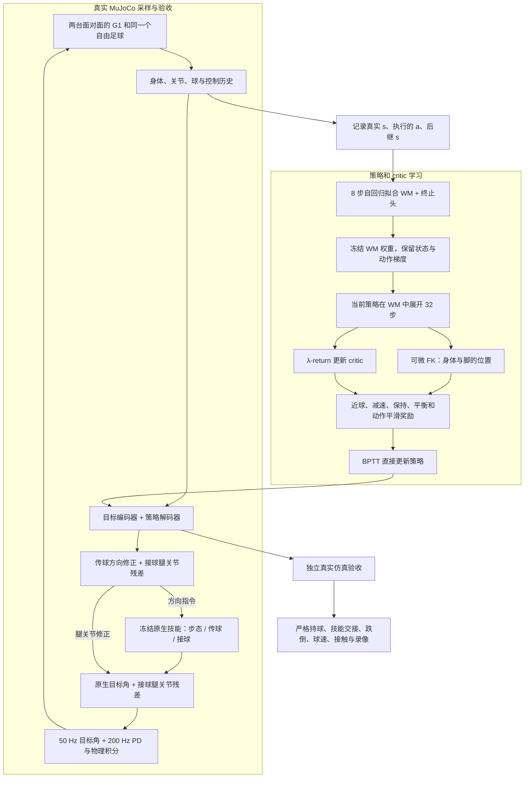

> 历史实验文档。当前研究状态以[根 README](../../README.md)和[实验协议](../research/cooperative_handoff/experiments/00_control_consistency/protocol.md)为准。

# G1 验证优先的 SuperMimic 适配

2026-11-09。用户同意优先用 G1 的原生足球技能检验训练架构，再回到 K1 迁移。当前为有状态真值输入的仿真实验，不是视觉闭环部署。

## 上一版哪些部分应当移除或改变

1. **默认教师的 WM 预测没有正收益证据。** v7/v8 同初态对照中，预测教师低于直接当前状态教师；把未来和当前位置平均再做比例控制没有接触优化能力。默认 OPD 只把这个规则压缩成网络。
2. **接收方动作空间缺失。** 只允许平移，不能专门控制脚的抬起、后撤、踝角和接触缓冲。不能把偶然碰球描述为学会接球。
3. **原默认并非 SuperMimic 的核心更新。** 想象梯度关闭，没有 critic；三轮是链路验证量级。多步 WM 损失下降本身不证明控制进步。
4. **身体坐标与关节状态重复预测，缺少几何一致性。** 新版仅预测根姿态、关节与球，身体坐标由 FK 计算。低层技能的历史仍须保存，才能使宏观控制模型近似 Markov。

## 当前实现



实线表示已实现接口；这张图不表示已取得性能提升。固定技能切换时序尚未学习。部署仅需要策略与原生技能，WM 和 critic 在训练侧使用。

当前只验收单次 A→B，**没有完成双方连续角色互换的循环传接**。后续循环控制应为：传球→接球→严格持球确认→接收方切换为传球方→角色互换。需要先通过单次严格持球和接球到传球的切换验收，再用完整循环回合采样，不能把把球摆回初态的 reset 当作连续传接。G1 两个角色目前加载的技能集合不同，角色交换还需让两台都加载 passing/receiving/locomotion，并处理技能历史和切换。

## 复用边界

- [SuperMimic 官方项目](https://supermimic.github.io/)目前可见论文、视频与演示，未找到作者训练仓库链接。
- 直接复用 [YHFone/supermimic-mjlab](https://github.com/YHFone/supermimic-mjlab) 社区实现的 `ActorCritic`（目标编码器、共享解码器、critic）、`RunningNorm` 与可微 FK，版本 `9aab0a588c6941bf9862a2d444b711fd73e2b832`。保留 Apache-2.0 许可和文件散列于 `soccer_sim/supermimic_core/`。只替换 mjlab 四元数工具导入，使其可在当前独立 MuJoCo 环境运行。
- 两台机器人、球、低层控制器记忆、奖励和采样器是本项目适配。使用 8 步拟合、32 步 BPTT、冻结 WM 权重和 λ-return critic。没有复制完整 mjlab Trainer，没有动作库跟踪任务；网络宽度、批量和历史接口也与原论文不同。因此称为 **SuperMimic 架构适配**，不称为官方代码或完整论文复现。
- G1 是带两自由度颈部的 31 关节 Joga 模型。K1 是 Booster 官方 22 自由度模型，B-Human `K1_walk.onnx` 输入 344、输出 13（12 个腿关节加频率）；没有 T1 腰关节。此前手臂姿态、模型阻尼、关节速度读取等存在上游适配差异，文件身份正确不保证运动风格完全一致。

## Joga / SoccerBot 资源能否使用

[Joga 演示](https://joga.csail.mit.edu/demo/)确实公开可读取的原生步态、接球和传球资源。接球文件 `policy_receiving_newball_fulldr_i99999.bin` 是 324 → 512 → 256 → 128 → 31 MLP，已读取并核对散列。本站仍标注 `Code (soon)`，不能据此声称完整训练代码已开源。模型和资源下载到忽略目录，不随本项目重新分发；来源清单为 `configs/joga_sources.json`。

[SoccerBot](https://soccerbot-humanoid.github.io/)也有公开可读的浏览器策略资源，原生为 29 关节 G1，采用运动先验和技能条件策略。它可作另一条 G1 基线，目前没有接入当前训练。不要与 GitHub 上同名的拾球/守门机器人项目混淆。

31/29 关节 G1 权重不能截去若干输出后就用于 22 关节 K1。关节与惯量、观测归一化、颈部相机、控制历史和足球接触都不同。G1 验证成功后，可在 G1 上采集接球/传球身体和球轨迹，重定向到 K1 后用作参考动作或蒸馏教师，再训练 K1；该重定向分支尚未实现。

Joga 网页队友演示使用两个独立 sim，出球后镜像足球，并修正方向和速度；其演示成功率不是本项目双机器人同世界成功率。本实现使用同一个模型中的两台 G1 和一个球，运行中不重设球位或球速；17° 方向偏置来自公开演示控制接口，是发送给策略的指令补偿，不是改球速度。原生碰撞参数保留，机器人间/自身碰撞屏蔽沿用原生部署设置，不能当作六机器人碰撞验证。

## 本次训练与验收规模

- 新配置：`configs/supermimic_g1_receive.yaml`；K1 补充对照：`supermimic_k1_receive.yaml`。
- 30 轮，初始 64 回合，每轮新增 16 回合，完整规模 528 回合、158400 个 50 Hz 转移；最近 256 回合用于拟合。
- 每轮 100 次 WM 更新（8 步窗口、batch 128），8 次策略更新（32 步、batch 64），每次策略更新有 3 次 critic 拟合。WM 256×256、actor/critic 128×128。规模大于上一版，不等同于原论文的数十万次迭代和数千并行环境。
- 固定 WM 验证种子 110000–110015；每 5 轮用监测种子 120000–120019 验收，另验第 1 轮。检查点按严格前向持球率、无跌倒、并列取早选取，允许保留原技能基线。
- 独立最终评估先固定种子 130000–130099，100 个配对初态，比较冻结原生技能、监测选中的策略和最后一轮；另做相同策略的接球腿残差归零消融。
- 只有一个训练随机种子；本次属于探索性架构验证。固定原生技能比较的是整个新训练方案，尚没有匹配计算量的 model-free RL 对照，不能单独归因于 WM。

G1 严格成功：先发送方后接收方真实接触力 >0.1 N，球曾移动 ≥2 m，球距接收方根部 <0.55 m、水平速度 <0.5 m/s、双方相向误差 ≤30°，连续 ≥0.8 s 且结束仍保持，无人跌倒。另报球是否处于接收方前方和前向严格成功。

G1 的 20 维动作接口中只有传球方向 1 维和接球腿 12 维生效；其余维度保留为跨 K1/G1 的接口兼容，掩码为零。历史运行配置包含从 K1 继承的 `kick_kind: bhuman_soft` 等未使用字段，**不会加载 B-Human 权重**；当前 G1 配置已移除这些无效项。原生资源身份以 `runtime.json` 和 `configs/joga_sources.json` 为准。

技能交接指标采用网页的 1.2 m / 0.6 m/s / 0.8 s 范围，并额外要求有序真实接触、面对面和无跌倒。它表示下一项球技的接近范围，**不等于严格持球**；不能合并成功率。G1 原生场景的球半径 0.11 m、质量 0.43 kg，模型 200 Hz、策略 50 Hz；不是 K1 HSL 场地球参数的官方标准。场地、接触与机器人全部实际参数随运行保存至 `runtime_scene.xml` 与 `runtime_actuation.json`，原始配置在 `assets/joga/scene.xml`、`skills.json`；改动物理参数后须重建并重采样。

Joga 原网页使用 MuJoCo 3.12.0。旧环境 3.3.7 与 3.12.0 会产生不同接触轨迹，分别保留为 `runs/direct_g1_receive_30_mj337` 和 `runs/direct_g1_receive_30_mj312`，不合并成功率。主验证采用 3.12.0，旧环境只作版本对照。完整参数和覆盖示例见 [G1_PARAMETERS.md](G1_PARAMETERS.md)。

新机器：

```bash
python3.11 -m venv .venv-joga312
.venv-joga312/bin/pip install -r requirements-g1-validation.txt
```

当前服务器：

```bash
cd <project-root>
PYTHONPATH=. .venv-joga312/bin/python tools/fetch_joga.py
PYTHONPATH=. OPENBLAS_NUM_THREADS=1 .venv-joga312/bin/python -m soccer_sim.direct_train \
  --config configs/supermimic_g1_receive.yaml --out runs/new_g1 --device cuda:0
PYTHONPATH=. OPENBLAS_NUM_THREADS=1 .venv-joga312/bin/python -m soccer_sim.direct_eval \
  runs/new_g1 --seed 130000 --episodes 100
```

不要在 `.venv-joga312` 中执行默认 `pip install -e .`，因为旧 K1 项目的 `pyproject.toml` 仍固定 MuJoCo 3.3.7。
