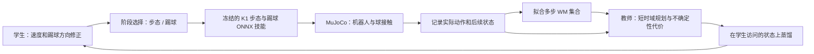

> 历史实验文档。当前研究状态以[根 README](../../README.md)和[实验协议](../research/cooperative_handoff/experiments/00_control_consistency/protocol.md)为准。

# K1 双机器人：世界模型与策略交替更新

2026-11-09，服务器 `<project-root>`。这是借鉴 SuperMimic 数据闭环的任务专用实现，当前验证两台浮动基座机器人的一次传接球。循环交换球权、六机器人对抗和真机迁移尚未验证。

**当前默认场景已按用户要求改为面对面。** `configs/wm_pass_facing_gentle.yaml` 使用独立的 B-Human K1 步态/软踢球网络，最终实验和对照为 `wm_facing_v7_gentle` / `wm_facing_v8_gentle_no_wm`，三轮结果见 [WORLD_MODEL_RESULTS.md](WORLD_MODEL_RESULTS.md)。早期面对面配置 `wm_pass_facing.yaml` 对应 v5/v6；同向 v1–v4 也保留，不能作为面对面场景的验证。

`wm_pass_facing_gentle.yaml` / `wm_pass_facing_gentle_no_wm.yaml` 是随后的低速接球课程（v7/v8）：接球口从根部前方 0.16 m 调整到 0.24 m，教师平移指令限幅 ±0.2（乘步态速度 scale 后为 ±0.05 m/s），位置死区 0.03 m；球距根部 <0.34 m 且水平速度 <0.5 m/s 时，教师标注零平移指令，避免再次撞球。这是教师规则的修改，不是修改摩擦或放宽接球判据。新独立评估使用 70000–70039 初态；60000–60039 是 v5/v6 的面对面验证集，后续方案设计参考过其结果。

## 从 SuperMimic 迁移什么

[SuperMimic 论文](https://arxiv.org/abs/2610.28480)和[官方项目](https://supermimic.github.io/)交替采集当前策略的数据、拟合可微动力学、通过冻结权重的 WM 更新策略。论文采用 8 步自回归拟合、32 步想象及价值函数。冻结 WM 权重时，仍保留状态和动作的梯度。

本实现迁移其采样和多步预测思路，增加球状态、教师规划和学生动作蒸馏。未使用 G1 权重、动作库或奖励，也不是完整论文复现。[社区 mjlab 实现](https://github.com/YHFone/supermimic-mjlab)可作为后续 FK 和价值函数实现的参考；本目录 WM、教师和训练器为本项目编写。



这里 OPD 指学生自己采样、教师在学生访问过的状态上标注、聚合数据后动作回归，接近 DAgger。不是某篇语言模型 OPD 方法的完整复现。有限轮数的交替训练也不等于无限自我改进。

## 独立底层技能

面对面版本来自 [B-Human 发布仓库](https://github.com/bhuman/BHumanCodeRelease)，固定版本 `2e3374ba896da8288607f9a1881b876642fe18b8`。独立权重为 `K1_walk.onnx`（344 → 13）与 `K1_kick_inner_soft.onnx`（59 → 13）。[官方接口文档](https://docs.b-human.de/master/motion/motion-walking-kicking/)描述了历史、相位、踢球方向和目标球速。精确输入以固定版本的 `WalkingEngine.cpp` 为准，其第 9 个踢球输入为方向角/π，不是球高度。输出为 12 个腿关节偏移和频率偏移；头与手臂保持固定默认姿势，沿用串联关节接口。来源及 SHA-256 在 `configs/bhuman_skill_sources.json`，许可保留于下载目录的 `License.md`，须遵守其条款。

步态历史为 10 帧，按旧到新排列；50 Hz 推理，频率基准 1.5 Hz，输出频偏限幅 ±0.5 Hz，腿关节目标偏移限幅 ±2 rad。踢球观测中的球位置为躯干 yaw 旋转后的双踝原点中点相对位置，球速度同样旋转并限幅至 2 m/s。此处双踝中点是对上游双足底原点的近似；上游有球位修正和动作框架逻辑，本适配没有完整移植。腿部 PD 采用上游 `regular` 配置的 kp `[80,80,80,80,50,25]`、kd `[4,4,4,4,2,2]`，左右腿相同；手臂/头使用既有 NUbots 的低增益默认姿态，整体仍受官方 MJCF 力矩限制。它是仿真适配，不能称为完整复现上游控制器。

初始双方间距约 1.2 m；每次 reset 根据带噪接收方位置设发送方 yaw=atan2(y,x)、接收方 yaw=发送方 yaw+π。球位置以发送方局部坐标采样后转换到世界坐标。运行中不重设根部姿态：步态网络接收 `clip(1.5×朝向误差, ±0.6)` rad/s 的转向指令；踢球方向指向队友当前位置。yaw 纠正是显式控制器，不是学生已经学到的技能。发送方在 0.2–2.6 s 调用软踢球，其余时段调用步态；接收方调用步态。这是阶段调用原型，尚未学习接球脚的缓冲轨迹。

接球的连续保持窗口中，双方前向向量都必须与“指向对方”的水平向量夹角 ≤30°。这项朝向约束和原接触、距离、速度、保持时间判据同时成立，不能仅靠初始姿态算作面对面成功。配置保留 `facing_mode`、`facing_tolerance_deg`、`face_yaw_gain`、`kick_kind`、`kick_direction_mode`、`kick_speed`、`skill_kp_scale`、`skill_kd_scale` 等接口。软踢球目标球速 0.4 m/s 是策略输入，不保证实际出球速度等于 0.4 m/s。

NUbots 的侧向扫踢在面对面场景直接输入前向方向时，开发集 6 次均跌倒，因此未沿用该方法。下面的 NUbots 说明对应保留的旧实验。

来源：[NUbots/NUbots_K1](https://github.com/NUbots/NUbots_K1)，固定版本 `023d1c41f736d62667eda3f77c852c3655ddba25`，根 `LICENCE` 为 MIT。下载清单与 SHA-256 为 `configs/skill_sources.json`，校验脚本为 `tools/fetch_skills.py`。

| 技能 | 发布权重 | 观测 → 动作 |
|---|---|---|
| 步态 | `SimK1Walk/data/walk.onnx` | 79 → 22 |
| 踢球 | `SimK1Kick/data/kick.onnx` | 80 → 22 |

踢球为侧向扫踢，不能假定能任意方向、任意距离传球。它读取球在躯干坐标系的位置与方向指令；步态读取机体系 vx/vy/wz。按 SDK 串联关节顺序、各自原始观测布局加载，50 Hz 推理，1 kHz PD 力矩积分。

每台独立保存上一动作、相位和切换状态；同一时刻仅一种技能控制一台机器人。本适配层采用相位连续和 0.3 s 目标角插值，与上游独立任务启动时重置相位的方式存在区别，不能称为完全相同的部署实现。步态关节范围用于目标限幅，步态头部保持默认角。

使用官方 K1 串联 MJCF 和已有场地接触参数，按 NUbots YAML 加载 kp/kd/default pose/action scale。清零 MJCF 被动 damping，避免 kd 重复计算；力矩受官方 MJCF 上限约束。未完整复现 NUbots 训练碰撞模型和执行器上限，仍存在动力学差异。没有扶持力，也没有直接给球施加踢球外力。

## 状态、动作与模型

精确切片保存在每次运行的 `state_layout.json`。旧 NUbots 状态为 431 维；面对面 B-Human 为 1077 维，额外包含两台各自 320 维步态历史、频率和旧球位。包含：

- 两台躯干位置、旋转矩阵、根速度、22 关节角和速度。
- 所有机器人身体部件世界坐标，包括脚、四肢和头部。
- 技能上一动作、目标角、切换插值起点/时间、相位和当前技能。
- 球三维位置、线速度/角速度、回合时间、摩擦/质量/半径上下文。

动作 8 维：两台各自 vx/vy/wz 共 6 维，加各自踢球方向偏移 2 维。一次传球只激活 A1 的踢球项；A2 踢球项为后续交换球权保留。本实验阶段时序固定，未学习阶段调度。

WM 为两个独立初始化的 MLP，各含两层 256 隐藏单元，预测下一状态残差。球和根位置有常速度先验，上下文保持不变，其余由模型学习。NUbots 固定相位解析推进，B-Human 的可变频率相位由模型预测。身体位置直接解码，尚未使用可微 FK 强制刚体一致性。脚球接触数据来自 MuJoCo；梯度仅通过 WM。

控制周期 0.1 s，8 步训练窗口为 0.8 s，与论文 50 Hz 下的 8 步时间不同。窗口不跨回合，记录实际执行的带噪指令。按初始训练数据标准化，多步状态误差额外加权球位置。

教师有两种实现：早期版本通过 WM 梯度优化有界指令序列，代价包括接球口距离、躯干高度/直立程度、接收方位移、动作幅度和模型分歧；当前默认版本采用下面所述的结构化预测拦截教师。学生为两层 128 隐藏单元 MLP，蒸馏动作 MSE。代码支持额外 4 步 WM 梯度更新，但当前默认关闭；没有终端价值函数。

## 参数与验证

物理参数接口见 [PARAMETERS.md](PARAMETERS.md)。`SkillPassEnv` 从 `hsl_m_3v3.yaml` 读取环境配置；修改摩擦、质量等后应重新构建、重新采样，不能沿用旧 WM 的准确性结论。

`configs/wm_pass.yaml` 为第一版；`wm_pass_conservative.yaml` 为后续保守版本。默认初始 64 回合、每轮新增 32 回合，共 3 轮；每轮每个 WM 更新 700 次，batch 128、学习率 4e-4；教师查询 512 状态，学生更新 400 次。第一版规划 8 步；保守版本规划 3 步、学生指令限制 ±0.25、模型分歧按 0.03 m 缩放，关闭额外学生想象损失。

`wm_pass_intercept.yaml` 为第三版课程：保留发送方原有技能，仅学习接收方平移。教师先用 WM 推进 3 步，将未来与当前的球位/接收方位置各平均，再生成接球口的位置反馈指令；这是一种结构化预测拦截教师，不是直接 BPTT 教师。学生仍在自身数据上进行动作蒸馏。`wm_pass_no_wm.yaml` 为匹配对照：相同学生、动作掩码、标注次数和采样轮数，只用当前状态生成教师指令，完全跳过 WM 拟合。可以区分接球课程与 WM 预测各自的作用。

初始球位置和接球机器人位置随机化；本次未进行视觉噪声、延迟、摩擦或质量域随机化。物理上下文保留了接口，但数据不足以验证跨物理参数泛化。

训练种子从 104 起。WM 固定验证 10000–10015，整回合隔离，未参与拟合或教师查询。验证集按各版本动作掩码采集，因此只能直接比较同一版本训练前后的 RMSE，不能把不同版本的误差视为同分布比较。每轮仿真监测为 20000–20019；它被用于后续方案设计，不能当成最终泛化证据。第一版另测过 30000 起初态；拦截课程只用 40000–40005 的开发初态做可行性检查。最终统一配对评估为 50000–50039，所有检查点和基线采用相同初态，未参与教师或学生训练。

WM 验证报告 0.1/0.5/1.0 s 球和身体位置 RMSE，单位米；1 s 超过训练窗口。与未学习的常速度先验比较。真实仿真另报碰球、接球事件、结束时持球、严格成功、跌倒、最近距离和最终目标误差，不能用 WM loss 替代成功率。`final_target_error` 是球到接收方**初始位置**的距离；主动移动接球时可能变大，因此它只是固定落点诊断，不能作为移动接球任务的主指标。严格成功和结束时球到接收方的实际距离更相关。

接球事件：接收方曾碰球，球距其根部 <0.3 m、水平速度 <0.5 m/s，连续 0.3 s。事件不保证最后持球。独立评估严格成功还要求发送方先碰球、接收方后碰球、球曾移动 ≥0.3 m、结束时仍满足保持条件、无人跌倒。跌倒为根高度 <0.35 m 或直立余弦 <0.65。这些短距离判据与旧固定骨盆测试不同，成功率不能混用。

## 复现与输出

```bash
cd simulation
python3.11 -m venv .venv-wm
.venv-wm/bin/pip install -e '.[test,wm,analysis]'
.venv-wm/bin/python tools/fetch_assets.py
.venv-wm/bin/python tools/fetch_skills.py
.venv-wm/bin/python -m soccer_sim.wm_train \
  --config configs/wm_pass_facing_gentle.yaml --output runs/my_wm --device cuda:0
.venv-wm/bin/python -m soccer_sim.wm_eval runs/my_wm --episodes 40 --seed 70000
```

先使用 `--smoke` 验证链路；CPU 可用 `--device cpu`。服务器新建 `.venv-wm`，通过只读 site 路径复用既有 Torch 2.7.0，未改动既有训练环境或中断其他任务。首个进程约占 528 MiB 显存，共享 GPU 的耗时不能视为独占基准。

输出含实际配置、状态布局、运行版本、源文件快照和散列、检查点、回放数据、教师标签、预测样本、逐回合评估和曲线。`.npz` 数据不需要 pickle。`runtime_scene.xml` 为适配后模型，`runtime_actuation.json` 记录实际 kp/kd/力矩和 damping。第一版早期 `scene.xml` 是适配前 XML，应使用补存的 `runtime_scene.xml`。

一次传球稳定后，再增加“靠近对齐 → 踢球 → 预测落点拦截 → 缓冲保持 → 确认球权 → 交换角色”，以及角色对称数据、阶段时机学习、接球技能、可微 FK/一致性约束和价值函数。当前不宣称已学会双机器人无限循环传球。
